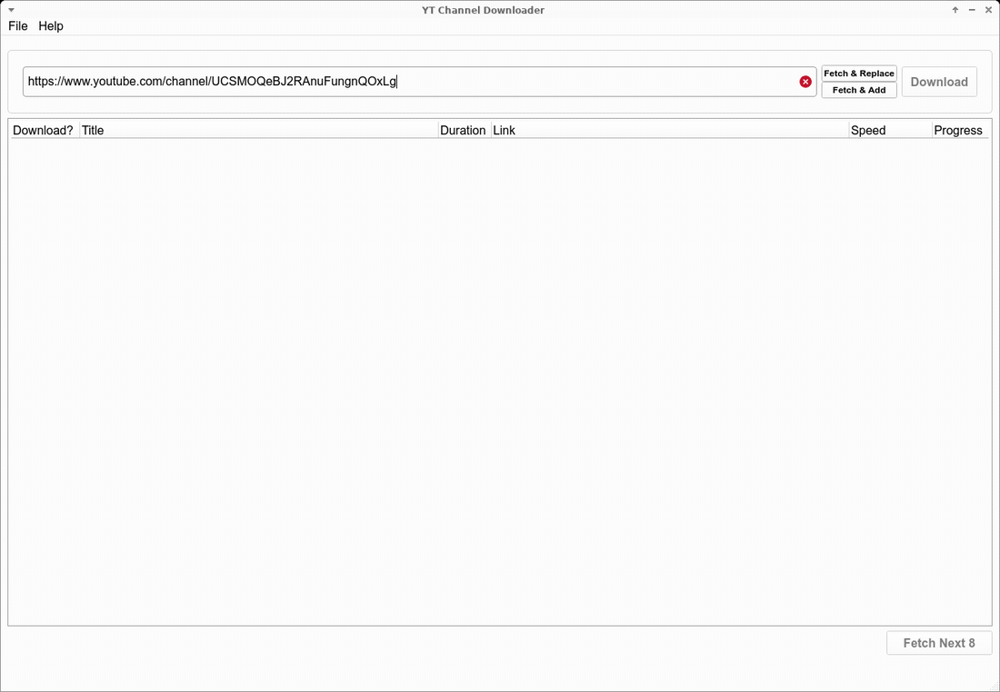
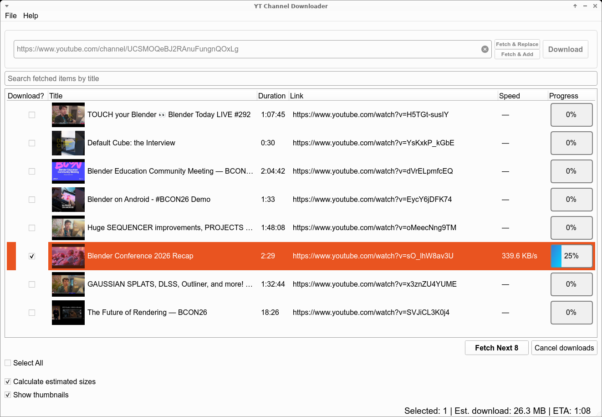
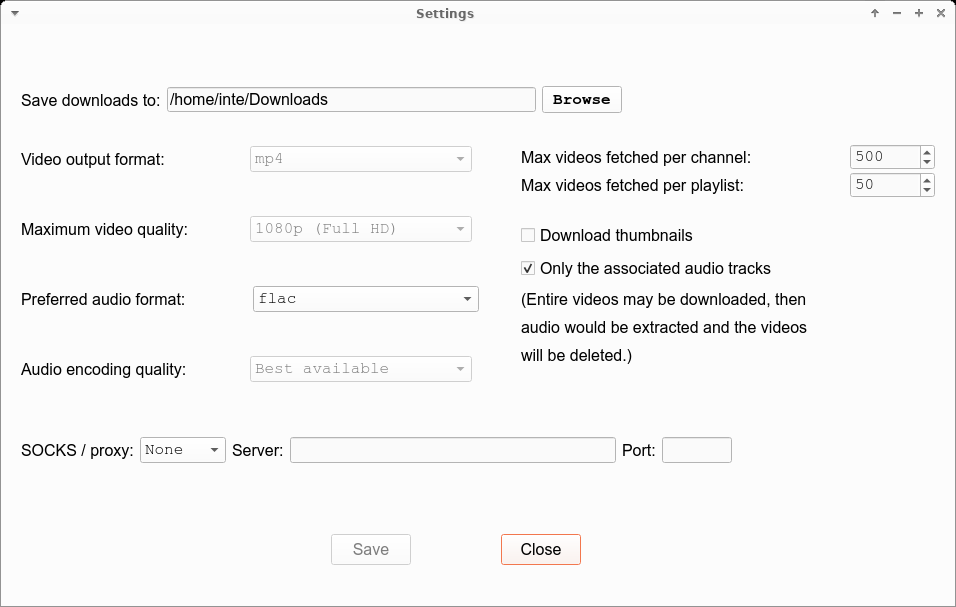
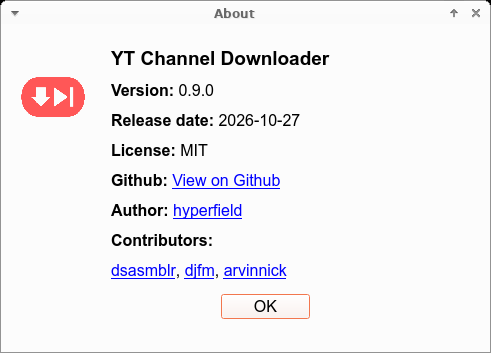
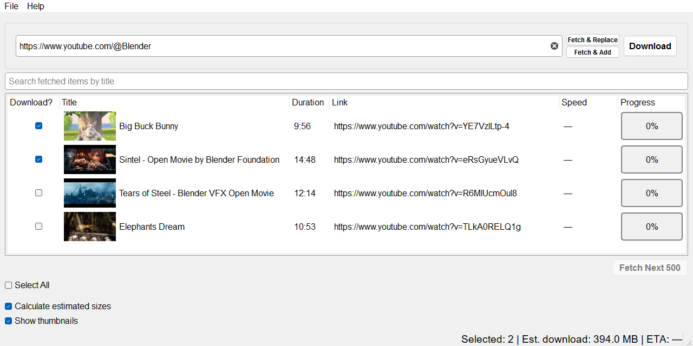
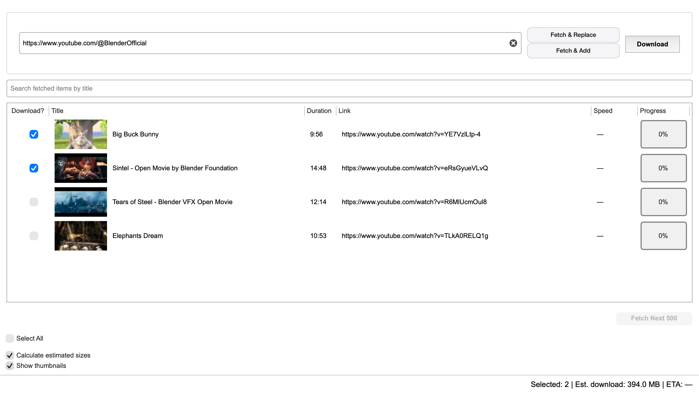

# YT Channel Downloader

[](https://pypi.org/project/yt-channel-downloader/) [](https://app.codacy.com/gh/hyperfield/yt-channel-downloader/dashboard?utm_source=gh&utm_medium=referral&utm_content=&utm_campaign=Badge_grade) [](https://ko-fi.com/hyperfield) [](https://sourceforge.net/projects/yt-channel-downloader/files/latest/download) [](https://sourceforge.net/projects/yt-channel-downloader/files/latest/download)

[](https://sourceforge.net/projects/yt-channel-downloader/files/latest/download)

**YT Channel Downloader** is a PyQt 6 desktop app for downloading YouTube channels, playlists, and individual media links supported by [yt-dlp](https://github.com/yt-dlp/yt-dlp).

This README describes the current source checkout, including the [0.9.0 changes](CHANGELOG.md#090). Published packages and binaries can have different requirements and behavior; check their release notes.



Captured on Linux with version 0.9.0 using [Blender's public YouTube channel](https://www.youtube.com/@BlenderOfficial). The 13-second animation omits waiting time.

<details>
<summary>Current screenshots (Linux, version 0.9.0)</summary>

**Main window during a download**



**Video settings**


**Audio settings**



**About**



</details>

<details>
<summary>Earlier Windows and macOS screenshots</summary>

These images are from earlier releases and show older controls and labels.




[Earlier Windows Settings screenshot](docs/images/ytdl-settings_win.png) · [Earlier Windows animation](docs/images/yt-chan-dl-win.gif)

</details>

---

- [Change Log](#change-log)
- [Binaries](#binaries)
- [Features](#features)
- [Installation](#installation)
  - [Requirements](#requirements)
  - [Install from PyPI](#install-from-pypi)
  - [Install the .deb (Debian/Ubuntu)](#install-the-deb-debianubuntu)
  - [macOS or Linux (from source)](#macos-or-linux-from-source)
  - [Windows](#windows)
  - [Updating](#updating)
- [How to Use](#how-to-use)
- [Settings & Troubleshooting](#settings--troubleshooting)
- [Contributing](#contributing)
- [License](#license)
- [Authors](#authors)
- [Donation](#donation)

## Change Log

### 0.9.0 (current source)

Release date: 2026-10-27

- Python 3.14+ and refreshed dependency minimums.
- Consistent format/quality settings, safer filenames and completion detection, and improved non-YouTube handling.
- Background size estimates and improved cancellation.

### 0.8.9 (published on PyPI)

- Raised the minimum `yt-dlp` dependency to `2026.03.17` to address YouTube `HTTP 403` download failures.
- Documented that PyPI users should upgrade `yt-dlp`.

[Full changelog](CHANGELOG.md).

## Binaries

Browse [available downloads on SourceForge](https://sourceforge.net/projects/yt-channel-downloader/files/) and [release notes on GitHub](https://github.com/hyperfield/yt-channel-downloader/releases). Choose the build for your operating system and architecture.

Bundled builds include Python and the app's Python dependencies. Install FFmpeg and a supported JavaScript runtime separately as described under [Requirements](#requirements). Binary releases may lag behind the source checkout and PyPI releases.

## Features

- **Fetch & Replace / Fetch & Add**: Replace the current list or append newly fetched items to it.
- **Search Within Fetched Items**: Filter the current list by title with the built-in search field.
- **Fetch Video Listings**: Input a YouTube video, playlist, or channel URL and get a list of matching items.
- **Selective Download**: Choose exactly which videos you want to download, or select all at once.
- **Quality Control**: Set a maximum video resolution, choose an output container, or extract audio with an optional encoding bitrate.
- **Completed-File Detection**: Recognize matching media already present in your download directory.
- **Size & Time Estimates**: Estimate selected download sizes in the background. ETA becomes available when transfer-speed samples exist; calculations can be cancelled.
- **Large-List Handling**: Channels can be fetched in batches with `Fetch Next`, and playlists use configurable fetch limits to keep fetching responsive.
- **Thumbnail Previews & Downloads**: See thumbnails as soon as items are fetched, and save them with your downloads.
- **YouTube Playlist and Channel Downloads**: Fetch items within the configured limits and choose which to download.
- **Single Video or Audio Downloads**: Use individual media links supported by yt-dlp, including sites such as Vimeo and SoundCloud. Bulk channel and playlist fetching remains YouTube-only.

  For other sites, use a link to one media item. Pages containing multiple videos or playlist entries are rejected with a message requesting a direct item link, so separate items cannot share an output filename. Single-item embeds and direct HTTP(S) media links are supported. The original page URL is retained to let yt-dlp refresh expiring stream URLs and required request headers.

- **Runtime Detection**: Get a prompt when fetching YouTube media if a supported Deno or Node.js runtime is missing.
- **Browser-Cookie Login for Restricted YouTube Content**: Reuse a signed-in browser profile for content that your account can access.

Provider support follows yt-dlp and can depend on account access. The app's login dialog validates YouTube browser cookies; it does not provide fields for provider-specific usernames or passwords.

## Installation

### Requirements

- **Python 3.14 or newer** for the current source checkout. Install Python from [python.org](https://www.python.org/downloads/) or your OS package manager. Bundled binaries include their own Python runtime.
- **FFmpeg and ffprobe**, available on the app's `PATH`, for merging streams, extracting audio, and converting formats.
- **A supported JavaScript runtime for full YouTube support**: [Deno 2.3.0 or newer](https://docs.deno.com/runtime/getting_started/installation/) (recommended by yt-dlp), or [Node.js 22.0.0 or newer](https://nodejs.org/en/download). The app enables both runtime types automatically. See [yt-dlp's runtime setup guide](https://github.com/yt-dlp/yt-dlp/wiki/EJS) for details.

The Python dependencies in [requirements.txt](requirements.txt) and [pyproject.toml](pyproject.toml) include `yt-dlp[default]` and its matching `yt-dlp-ejs` companion, plus SOCKS proxy support. They do not install FFmpeg or an external JavaScript runtime.

#### Install FFmpeg

On macOS with [Homebrew](https://brew.sh/):

```bash
brew install ffmpeg
```

On Debian/Ubuntu:

```bash
sudo apt update
sudo apt install ffmpeg
```

On Arch Linux:

```bash
sudo pacman -S ffmpeg
```

For Fedora/RHEL and other distributions, use the package sources linked from the [FFmpeg download page](https://ffmpeg.org/download.html).

On Windows, choose a Windows build linked from the [FFmpeg download page](https://ffmpeg.org/download.html), extract it, and add the directory containing both `ffmpeg.exe` and `ffprobe.exe` to `Path`. For example, use `C:\ffmpeg\bin` if that is where you extracted the executables. Open a new terminal after changing `Path`.

Verify both executables:

```text
ffmpeg -version
ffprobe -version
```

#### Install a JavaScript runtime

Follow the official installation instructions for [Deno](https://docs.deno.com/runtime/getting_started/installation/) or [Node.js](https://nodejs.org/en/download), then check `deno --version` or `node --version`. Ensure the executable is on the app's `PATH` and meets the minimum version above. Distribution repositories can ship older Node.js versions, so check the result of a package-manager installation.

### Install from PyPI

In an activated Python environment, install or upgrade the published app and yt-dlp together:

```bash
python -m pip install --upgrade yt-channel-downloader "yt-dlp[default]"
yt-channel-downloader
```

This installs the published release. To use the current [0.9.0 source](CHANGELOG.md#090), follow the source-install instructions below. Each published release declares its own Python requirements on [PyPI](https://pypi.org/project/yt-channel-downloader/).

### Install the .deb (Debian/Ubuntu)

1. Choose a `.deb` matching your system architecture from the [available downloads](https://sourceforge.net/projects/yt-channel-downloader/files/). If a suitable package is unavailable, use the source installation below.
2. Install FFmpeg and the JavaScript runtime as described under [Requirements](#requirements); the current `.deb` packaging does not install these dependencies automatically.
3. Install the downloaded file, replacing `VERSION` and `ARCH` with the actual filename:

   ```bash
   sudo apt install ./yt-channel-downloader_VERSION_ARCH.deb
   ```

4. Launch with `yt-channel-downloader`.

### macOS or Linux (from source)

Install the [requirements above](#requirements), then clone the repository and create an environment with Python 3.14:

```bash
git clone https://github.com/hyperfield/yt-channel-downloader.git
cd yt-channel-downloader
python3.14 -m venv .venv
```

For bash/zsh, activate it with:

```bash
source .venv/bin/activate
```

For fish, use `source .venv/bin/activate.fish`. If using a newer Python version or an existing virtual environment, check that `python --version` reports 3.14 or newer.

Install the project in editable mode and launch it:

```bash
python -m pip install --upgrade -r requirements.txt
yt-channel-downloader
```

Run `deactivate` when finished.

### Windows

For a published package, install the [requirements above](#requirements), activate a Python environment, and follow [Install from PyPI](#install-from-pypi).

To run the current source checkout, install Python 3.14+, Git, FFmpeg, and a supported JavaScript runtime, then use PowerShell:

```powershell
git clone https://github.com/hyperfield/yt-channel-downloader.git
cd yt-channel-downloader
py -3.14 -m venv .venv
.\.venv\Scripts\Activate.ps1
python -m pip install --upgrade -r requirements.txt
yt-channel-downloader
```

In Command Prompt, use `.venv\Scripts\activate.bat` to activate the environment. Run `deactivate` when finished.

### Updating

For a **PyPI installation**, rerun the installation command under [Install from PyPI](#install-from-pypi). Upgrading `yt-dlp[default]` also selects its matching companion dependencies.

For a **source checkout**, activate its Python 3.14+ environment and run from the repository root:

```bash
git pull
python -m pip install --upgrade -r requirements.txt
```

For a **bundled binary or .deb**, install a newer packaged build from the [available downloads](https://sourceforge.net/projects/yt-channel-downloader/files/). Updating yt-dlp with pip does not change the copy bundled inside an executable.

## How to Use

1. Open the application and enter a YouTube channel, playlist, or video URL, or an individual media URL from another supported site.
2. Open `File -> Settings`, choose your download directory, output format, quality, and fetch limits, then save. Enable **Only the associated audio tracks** for audio extraction.
3. Press **Fetch & Replace** to replace the current list, or **Fetch & Add** to append new items to the existing list.
4. Use the title search field and select the items you want to download. **Show thumbnails** controls previews; **Calculate estimated sizes** controls background size estimates. Saving thumbnails is a separate **Download thumbnails** option in Settings.
5. If you fetched a channel, use **Fetch Next** to load the next batch.
6. Hit the **Download** button.
7. Use **Cancel downloads** to stop active and queued jobs. Retrying the same source and output settings can reuse partial files when the source supports resuming.

## Settings & Troubleshooting

- **Fetch limits**: `File -> Settings` controls the items retrieved per channel fetch (default 500) and per playlist fetch (default 50), from 1 to 50,000. **Fetch Next** appends another channel batch; it is not available for playlists or non-YouTube sources.
- **Video format and quality**: **Maximum video quality** caps the resolution of sources that report it; unknown resolutions remain downloadable. **Video output format** selects the output container. FFmpeg preserves codecs through remuxing when possible and converts them when necessary, which can take longer.
- **Audio format and quality**: In audio-only mode, `Any` extracts audio without forcing a target codec. `flac` and `wav` convert to the selected lossless format; converting lossy audio does not restore lost detail. These three choices disable the bitrate field. Numeric bitrates apply to lossy encoding, even when the source already uses the requested codec. **Best available** avoids a user-selected bitrate and uses the source codec or the app's encoding defaults as needed.
- **Estimates**: Size estimates describe the source transfer, so conversion can change the saved file size. Missing duration or bitrate data can leave the estimate unknown; ETA needs transfer-speed samples.
- **Proxy support**: The Settings dialog includes `HTTP`, `HTTPS`, `SOCKS4`, and `SOCKS5` options, including IPv6 server addresses. Selecting `None` restores the proxy environment that existed when the app started. Invalid server/port values are rejected when saving.
- **Browser cookies**: Use `File -> Use Browser Cookies for Login` to choose a signed-in browser profile for restricted YouTube downloads. Once configured, the menu item changes to `Clear Login`, which removes the app's saved selection without signing the browser out.
- **Download filenames and completed items**: New filenames include a short suffix identifying the source and requested quality, format, and audio/video mode. Different videos with the same title and requests with different output settings get separate files. Title changes still reuse matching completed or partial downloads. Older title-only files are kept, but cannot automatically mark a request complete because their source and settings are unknown; the first download under the new scheme creates a separate file.
- **Earlier format rules**: Files created under earlier selection rules are kept; a new download may be needed to satisfy the current settings. Downloads receive their final filename after conversion succeeds. Intermediate files can be reused on a retry where supported.
- **YouTube 403 / missing formats**: For `HTTP Error 403`, `Requested format is not available`, `n challenge solving failed`, or `SABR` warnings, follow [Updating](#updating) for your installation type and check the JavaScript runtime version. Older yt-dlp builds can fail after YouTube player changes. Format-unavailable and HTTP 403/404 errors trigger broader selectors, including a combined video/audio stream when available. Retries keep the selected maximum reported resolution, but may choose a lower resolution.
- **Application logs**: If something fails and you want to report it, check the app log in the config directory under `logs/application.log`. On Linux this is typically `~/.config/yt_chan_dl/logs/application.log`.

## Contributing

Please see [CONTRIBUTING.md](CONTRIBUTING.md) for the contribution workflow, commit message conventions, and attribution guidelines. Issues and pull requests are welcome.

## License

This project is licensed under the MIT License. See the [LICENSE](LICENSE) file for details.

## Authors

- **hyperfield** - *Initial work* and *Documentation* - [hyperfield](https://github.com/hyperfield)

See also the list of [contributors](https://github.com/hyperfield/yt-channel-downloader/contributors) who participated in this project.

## Donation

If you like this application and want to support future development, I'll appreciate your donation via Ko-Fi or crypto. :)

[](https://ko-fi.com/hyperfield)  

**Bitcoin**: bc1pglp2m26kqatgm6z8vtuhk66jd74ghv948wtyhtgtj6wh30nzz6csjajv00

**Ethereum**: 0x9CEf6B928BF9fFd894ca83db1B822820917ca89a

**Tron**: TGq2z17jq8UruCNyyD5GU3weuyJSyM2zBp

**Binance Smart Chain**: 0x863F8f3fC38b7540110462884809621e2B9EE399
